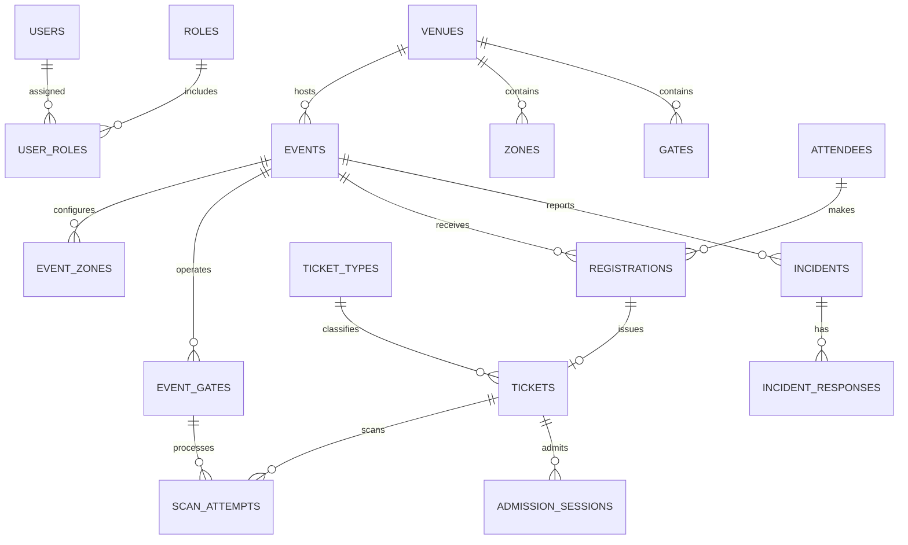

# EventCrowd architecture and data ownership

Next.js Route Handlers are the application API. PostgreSQL is the ACID source of truth for account identity, role assignments, ticket state, scan attempts, admissions, venue/event configuration, incidents and alerts. MongoDB stores heterogeneous observations, device events and scan-event replicas. No direct foreign-key constraints can cross SQL/Mongo boundaries.

## Scan sequence
1. Authenticated security worker submits token + gate + unique idempotency UUID.
2. PostgreSQL transaction validates gate, locks ticket `FOR UPDATE`, checks status and active admission.
3. Accepted scan creates an admission session or closes it on exit; rejected scans are logged without mutating occupancy.
4. An outbox message is committed with the transaction.
5. Worker retries delivery into MongoDB using `event_uuid` as a unique key.
6. Dashboard queries PostgreSQL's aggregate views; it is not dependent on MongoDB availability for authoritative counts.

## Crowd state
MongoDB `crowd_observations` may hold sensor or simulated population estimates. `zone_states` stores current projection (must be freshness-checked by the ingestion processor), while admitted venue attendance is based on `admission_sessions`. These values are different and must remain labeled distinctly.

## ER diagram (core)

## Advanced concepts
Unique partial index on active sessions; ACID transactions and row locking; CTE and window-query opportunities; PostgreSQL views; triggers for auditing incident mutations; SQL function for attendance; MongoDB aggregate operations on scan and crowd events.

## Deployment
The web server, PostgreSQL and MongoDB require provisioned endpoints and secrets. Outbox worker is a separate long-running process. A build passing locally does not prove deployed operational health. Record actual URLs and test evidence only after verification.
